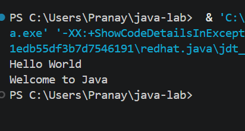
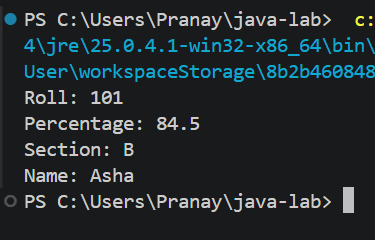
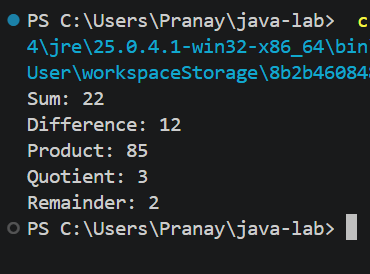
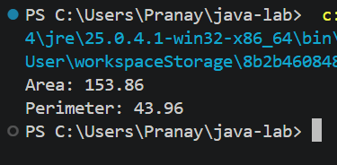

# EXPERIMENT NO. 1

## 1. Experiment Title
Hello World, Variables and Arithmetic

## 2. Aim
To print text, store values in variables and calculate with arithmetic operators in Java.

## 3. Software / Tools Required
- Programming Language: Java (JDK 21)
- IDE: Visual Studio Code
- Version Control: Git and GitHub

## 4. Theory
- **Output:** `System.out.println()` prints text and moves to the next line. `System.out.printf()` prints formatted output.
- **Variables:** A variable stores a value of a given data type: `int` (whole numbers), `double` (decimal numbers), `char` (single character) and `String` (text).
- **Arithmetic operators:** `+`, `-`, `*`, `/` and `%` (remainder). Dividing two `int` values gives an `int` result.
- **Constants:** A variable declared with the `final` keyword cannot be changed after it is assigned.

## 5. Algorithm / Procedure

**Q1 - Hello World**
1. Start.
2. Create class `Main` with the `main` method.
3. Print `Hello World`.
4. Print `Welcome to Java` on the next line.
5. Stop.

**Q2 - Variables**
1. Start.
2. Declare `int roll = 101`, `double percentage = 84.5`, `char section = 'B'` and `String name = "Asha"`.
3. Print each value on its own line after its label.
4. Stop.

**Q3 - Arithmetic Operators**
1. Start.
2. Declare `int a = 17` and `int b = 5`.
3. Calculate `a + b`, `a - b`, `a * b`, `a / b` and `a % b`.
4. Print each result after its label.
5. Stop.

**Q4 - Circle using a constant**
1. Start.
2. Declare `final double PI = 3.14` and radius = 7.
3. Calculate area = `PI * radius * radius`.
4. Calculate perimeter = `2 * PI * radius`.
5. Print the area and perimeter.
6. Stop.

## 6. Program / Queries / Commands
The complete source code of each question is in its own folder:

| Question | Source file |
|----------|-------------|
| Q1 | [Q1/Exp1Q1.java](Q1/Exp1Q1.java) |
| Q2 | [Q2/Exp1Q2.java](Q2/Exp1Q2.java) |
| Q3 | [Q3/Exp1Q3.java](Q3/Exp1Q3.java) |
| Q4 | [Q4/Exp1Q4.java](Q4/Exp1Q4.java) |

## 7. Input
- Question 1: Not Applicable
- Question 2: Not Applicable (values are stored in the program)
- Question 3: `a = 17`, `b = 5`
- Question 4: `radius = 7`, `PI = 3.14`

## 8. Output

**Q1**
```
Hello World
Welcome to Java
```


**Q2**
```
Roll: 101
Percentage: 84.5
Section: B
Name: Asha
```


**Q3**
```
Sum: 22
Difference: 12
Product: 85
Quotient: 3
Remainder: 2
```


**Q4**
```
Area: 153.86
Perimeter: 43.96
```


## 9. Result
All four programs were written and executed successfully in Visual Studio Code. Text was printed, variables of different data types were used, arithmetic operators were applied and a constant was declared with the `final` keyword.

## 10. Viva-Voce Questions
1. What is the difference between `print()` and `println()`?
2. What are the primitive data types used in this experiment?
3. Why is `17 / 5` equal to `3` and not `3.4` in Java?
4. What does the `%` operator do?
5. What is the use of the `final` keyword?
