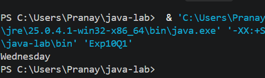
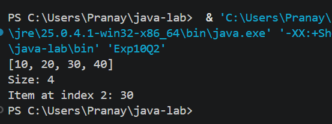
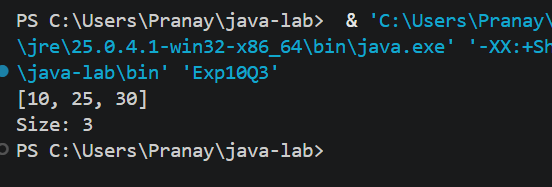

# EXPERIMENT NO. 10

## 1. Experiment Title
Switch and ArrayList

## 2. Aim
To choose a branch with a `switch` statement, and to store and change a list of numbers in an `ArrayList`.

## 3. Software / Tools Required
- Programming Language: Java (JDK 21)
- IDE: Visual Studio Code
- Version Control: Git and GitHub

## 4. Theory
- **switch statement:** Selects one of many branches based on the value of a variable. Each `case` ends with `break`, and `default` runs when no case matches.
- **ArrayList:** A resizable list from `java.util`. Unlike an array, its size grows and shrinks as items are added or removed. It stores objects, so `Integer` is used for whole numbers.
- **Common methods:** `add(value)` adds an item, `get(index)` reads an item, `set(index, value)` replaces an item, `remove(index)` deletes an item and `size()` gives the number of items.
- **Printing a list:** `System.out.println(list)` prints the items in square brackets, separated by commas.

## 5. Algorithm / Procedure

**Q1 - Day name using switch**
1. Start.
2. Store 3 in `day`.
3. Use `switch (day)`: case 1 prints `Monday`, case 2 prints `Tuesday`, case 3 prints `Wednesday`.
4. For any other value, the `default` case prints `Invalid day`.
5. Stop.

**Q2 - ArrayList basics**
1. Start.
2. Import `java.util.ArrayList` and create `ArrayList<Integer> list`.
3. Add the values 10, 20, 30 and 40.
4. Print the list.
5. Print `Size: ` followed by `list.size()`.
6. Print `Item at index 2: ` followed by `list.get(2)`.
7. Stop.

**Q3 - set and remove**
1. Start.
2. Create `ArrayList<Integer> list` and add 10, 20, 30 and 40.
3. Use `list.set(1, 25)` to change the item at index 1 to 25.
4. Use `list.remove(3)` to delete the item at index 3.
5. Print the list, then print `Size: ` followed by its size.
6. Stop.

## 6. Program / Queries / Commands
The complete source code of each question is in its own folder:

| Question | Source file |
|----------|-------------|
| Q1 | [Q1/Exp10Q1.java](Q1/Exp10Q1.java) |
| Q2 | [Q2/Exp10Q2.java](Q2/Exp10Q2.java) |
| Q3 | [Q3/Exp10Q3.java](Q3/Exp10Q3.java) |

## 7. Input
- Q1: `day = 3`
- Q2: Values added to the list: 10, 20, 30, 40
- Q3: Values added to the list: 10, 20, 30, 40

## 8. Output

**Q1**
```
Wednesday
```


**Q2**
```
[10, 20, 30, 40]
Size: 4
Item at index 2: 30
```


**Q3**
```
[10, 25, 30]
Size: 3
```


## 9. Result
All three programs were written and executed successfully in Visual Studio Code. A `switch` statement was used to print a day name, and an `ArrayList` was used to add, read, change and remove items.

## 10. Viva-Voce Questions
1. What is the use of `break` in a `switch` statement?
2. What is the purpose of the `default` case?
3. What is the difference between an array and an `ArrayList`?
4. Why do we write `ArrayList<Integer>` and not `ArrayList<int>`?
5. What is the difference between `set()` and `add()` in an `ArrayList`?
