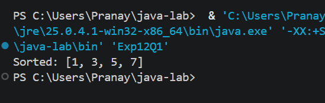
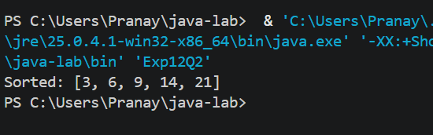
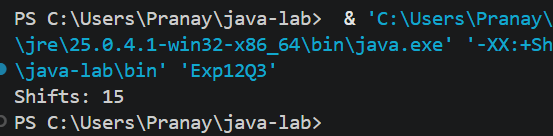

# EXPERIMENT NO. 12

## 1. Experiment Title
Insertion Sort

## 2. Aim
To sort small arrays with insertion sort and count how many values are shifted.

## 3. Software / Tools Required
- Programming Language: Java (JDK 21)
- IDE: Visual Studio Code
- Version Control: Git and GitHub

## 4. Theory
- **Insertion sort:** Builds the sorted array one element at a time. Each new element (the key) is compared with the sorted part on its left, the larger values are shifted one place to the right, and the key is inserted into the gap.
- **Shift:** Moving one value one place to the right to make room for the key.
- **Time complexity:** O(n^2) in the worst case (a reverse-sorted array) and O(n) in the best case (an already sorted array).
- **Shifts in the worst case:** For `n` elements in reverse order the shifts are `n(n - 1) / 2`. For 6 elements this is 15.

## 5. Algorithm / Procedure

**Q1 - Sort {7, 3, 5, 1}**
1. Start.
2. Create `int[] arr = {7, 3, 5, 1}`.
3. For `i = 1` to `n - 1`, store `arr[i]` in `key` and set `j = i - 1`.
4. While `j >= 0` and `arr[j] > key`, move `arr[j]` to `arr[j + 1]` and decrease `j`.
5. Place `key` at `arr[j + 1]`.
6. Print `Sorted: ` followed by the array.
7. Stop.

**Q2 - Sort {14, 3, 9, 21, 6}**
1. Start.
2. Create `int[] arr = {14, 3, 9, 21, 6}`.
3. Apply the same insertion sort steps as in Q1.
4. Print `Sorted: ` followed by the array.
5. Stop.

**Q3 - Count the shifts**
1. Start.
2. Create `int[] arr = {6, 5, 4, 3, 2, 1}` and set `shifts = 0`.
3. Apply insertion sort, and increase `shifts` by 1 every time a value moves one place to the right.
4. Print `Shifts: ` followed by `shifts`.
5. Stop.

## 6. Program / Queries / Commands
The complete source code of each question is in its own folder:

| Question | Source file |
|----------|-------------|
| Q1 | [Q1/Exp12Q1.java](Q1/Exp12Q1.java) |
| Q2 | [Q2/Exp12Q2.java](Q2/Exp12Q2.java) |
| Q3 | [Q3/Exp12Q3.java](Q3/Exp12Q3.java) |

## 7. Input
- Q1: `arr = {7, 3, 5, 1}`
- Q2: `arr = {14, 3, 9, 21, 6}`
- Q3: `arr = {6, 5, 4, 3, 2, 1}`

## 8. Output

**Q1**
```
Sorted: [1, 3, 5, 7]
```


**Q2**
```
Sorted: [3, 6, 9, 14, 21]
```


**Q3**
```
Shifts: 15
```


## 9. Result
All three programs were written and executed successfully in Visual Studio Code. Arrays were sorted using insertion sort, and the number of shifts for a reverse-sorted array was counted.

## 10. Viva-Voce Questions
1. How does insertion sort work?
2. What is the `key` in insertion sort?
3. What is the best-case and worst-case time complexity of insertion sort?
4. Why are there 15 shifts for the array `{6, 5, 4, 3, 2, 1}`?
5. How is insertion sort different from selection sort?
