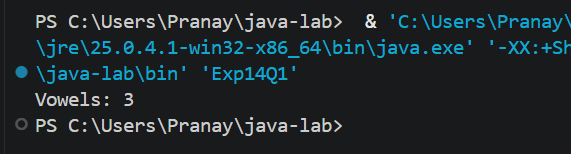
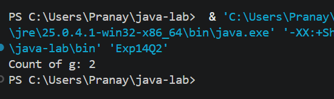
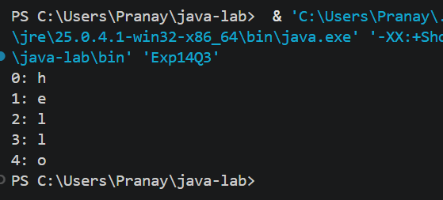

# EXPERIMENT NO. 14

## 1. Experiment Title
Characters: Counting and Positions

## 2. Aim
To use `charAt` to count vowels and a letter, and to print each letter with its position.

## 3. Software / Tools Required
- Programming Language: Java (JDK 21)
- IDE: Visual Studio Code
- Version Control: Git and GitHub

## 4. Theory
- **char:** A data type that stores a single character, written in single quotes, for example `'g'`.
- **charAt(i):** Returns the character at position `i` of a `String`. Positions start from 0 and the last position is `length() - 1`.
- **Traversing a string:** A `for` loop from 0 to `s.length() - 1` visits every character once.
- **Counting:** A counter variable is increased every time a character matches the condition, for example a vowel (`a, e, i, o, u`) or a given letter.
- **Comparison:** Characters are compared with `==`, and several conditions are joined with `||` (OR).

## 5. Algorithm / Procedure

**Q1 - Count vowels**
1. Start.
2. Store `programming` in `s` and set `count = 0`.
3. Repeat for every position `i`: get `c = s.charAt(i)`.
4. If `c` is `a`, `e`, `i`, `o` or `u`, increase `count` by 1.
5. Print `Vowels: ` followed by `count`.
6. Stop.

**Q2 - Count a letter**
1. Start.
2. Store `programming` in `s` and set `count = 0`.
3. Repeat for every position `i`: if `s.charAt(i)` is `g`, increase `count` by 1.
4. Print `Count of g: ` followed by `count`.
5. Stop.

**Q3 - Letters with positions**
1. Start.
2. Store `hello` in `s`.
3. Repeat for `i = 0` to `s.length() - 1`.
4. Print `i`, a colon, a space and `s.charAt(i)`.
5. Stop.

## 6. Program / Queries / Commands
The complete source code of each question is in its own folder:

| Question | Source file |
|----------|-------------|
| Q1 | [Q1/Exp14Q1.java](Q1/Exp14Q1.java) |
| Q2 | [Q2/Exp14Q2.java](Q2/Exp14Q2.java) |
| Q3 | [Q3/Exp14Q3.java](Q3/Exp14Q3.java) |

## 7. Input
- Q1: `s = "programming"`
- Q2: `s = "programming"`
- Q3: `s = "hello"`

## 8. Output

**Q1**
```
Vowels: 3
```


**Q2**
```
Count of g: 2
```


**Q3**
```
0: h
1: e
2: l
3: l
4: o
```


## 9. Result
All three programs were written and executed successfully in Visual Studio Code. `charAt` was used to count the vowels and a given letter in a word, and to print each letter with its position.

## 10. Viva-Voce Questions
1. What does the `charAt()` method return?
2. What is the index of the first and the last character of a string?
3. What is the difference between `char` and `String`?
4. Which vowels are counted in Q1?
5. What happens if we call `charAt()` with an index equal to `length()`?
