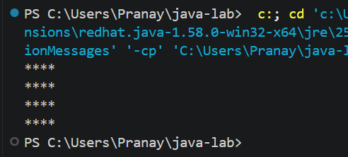
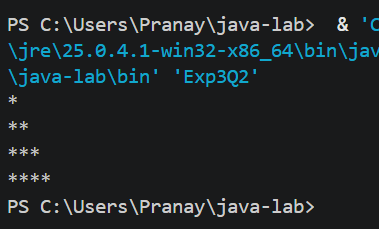
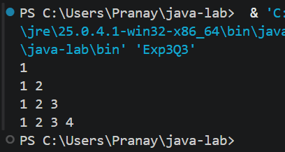
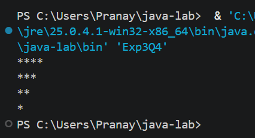

# EXPERIMENT NO. 3

## 1. Experiment Title
Star and Number Patterns

## 2. Aim
To use a loop inside another loop to print stars and numbers in rows.

## 3. Software / Tools Required
- Programming Language: Java (JDK 21)
- IDE: Visual Studio Code
- Version Control: Git and GitHub

## 4. Theory
- **Nested loops:** A loop written inside another loop. The inner loop runs completely for every single run of the outer loop.
- **Pattern printing:** The outer loop controls the rows and the inner loop controls the columns (stars or numbers) in each row.
- **print() and println():** `print()` stays on the same line, `println()` moves to the next line.
- In a right triangle the inner loop runs up to the row number `i`, and in an upside-down triangle the outer loop counts down.

## 5. Algorithm / Procedure

**Q1 - Square of stars**
1. Start.
2. Repeat the outer loop for `i = 1` to `4` (rows).
3. Repeat the inner loop for `j = 1` to `4` (columns) and print `*`.
4. After the inner loop, move to the next line.
5. Stop.

**Q2 - Right triangle of stars**
1. Start.
2. Repeat the outer loop for `i = 1` to `4`.
3. Repeat the inner loop for `j = 1` to `i` and print `*`.
4. After the inner loop, move to the next line.
5. Stop.

**Q3 - Number triangle**
1. Start.
2. Repeat the outer loop for `i = 1` to `4`.
3. Repeat the inner loop for `j = 1` to `i` and print `j` followed by a space.
4. After the inner loop, move to the next line.
5. Stop.

**Q4 - Upside-down triangle of stars**
1. Start.
2. Repeat the outer loop for `i = 4` down to `1`.
3. Repeat the inner loop for `j = 1` to `i` and print `*`.
4. After the inner loop, move to the next line.
5. Stop.

## 6. Program / Queries / Commands
The complete source code of each question is in its own folder:

| Question | Source file |
|----------|-------------|
| Q1 | [Q1/Exp3Q1.java](Q1/Exp3Q1.java) |
| Q2 | [Q2/Exp3Q2.java](Q2/Exp3Q2.java) |
| Q3 | [Q3/Exp3Q3.java](Q3/Exp3Q3.java) |
| Q4 | [Q4/Exp3Q4.java](Q4/Exp3Q4.java) |

## 7. Input
- Q1: Not Applicable (4 rows and 4 columns are fixed in the program)
- Q2: Not Applicable (4 rows)
- Q3: Not Applicable (4 rows)
- Q4: Not Applicable (4 rows)

## 8. Output

**Q1**
```
****
****
****
****
```


**Q2**
```
*
**
***
****
```


**Q3**
```
1 
1 2 
1 2 3 
1 2 3 4 
```


**Q4**
```
****
***
**
*
```


## 9. Result
All four programs were written and executed successfully in Visual Studio Code. Nested loops were used to print a square, a right triangle, a number triangle and an upside-down triangle.

## 10. Viva-Voce Questions
1. What is a nested loop?
2. Which loop controls the rows and which controls the columns in a pattern?
3. What is the difference between `print()` and `println()`?
4. How many times does the inner loop run in total in Q1?
5. How do you change Q2 to print an upside-down triangle?
