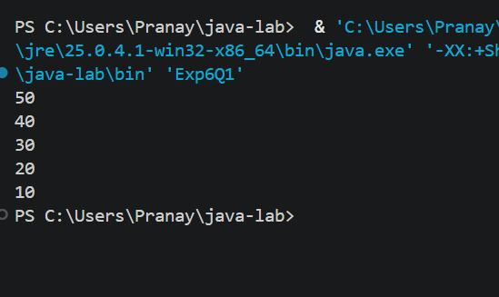
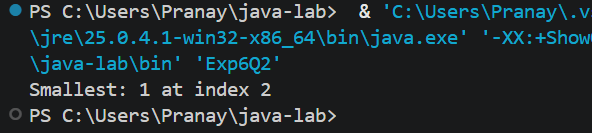
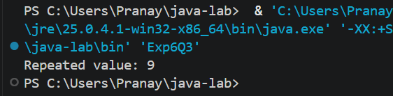

# EXPERIMENT NO. 6

## 1. Experiment Title
Arrays: Reverse and Duplicates

## 2. Aim
To print an array in reverse order, find the smallest value, and check an array for repeated values.

## 3. Software / Tools Required
- Programming Language: Java (JDK 21)
- IDE: Visual Studio Code
- Version Control: Git and GitHub

## 4. Theory
- **Reverse traversal:** An array can be visited from the last index (`arr.length - 1`) down to index 0 with a decreasing loop.
- **Smallest value:** Assume the first element is the smallest, then compare it with every other element and update it (and its index) when a smaller value is found.
- **Duplicate check:** Two nested loops compare each element with all the elements after it. If two are equal, the value is repeated.
- **break:** Stops the inner loop as soon as a repeated value is found.

## 5. Algorithm / Procedure

**Q1 - Reverse order**
1. Start.
2. Create `int[] arr = {10, 20, 30, 40, 50}`.
3. Repeat for `i = arr.length - 1` down to `0`.
4. Print `arr[i]` on its own line.
5. Stop.

**Q2 - Smallest value and its index**
1. Start.
2. Create `int[] arr = {2, 5, 1, 8, 3, 4}`.
3. Set `smallest = arr[0]` and `index = 0`.
4. Repeat for `i = 1` to `arr.length - 1`: if `arr[i] < smallest`, set `smallest = arr[i]` and `index = i`.
5. Print `Smallest: ` followed by the value, then ` at index ` and the index.
6. Stop.

**Q3 - Repeated value**
1. Start.
2. Create `int[] arr = {4, 9, 2, 9, 7}` and set `found = false`.
3. Repeat the outer loop for each `i`, and the inner loop for `j = i + 1` to the end.
4. If `arr[i] == arr[j]`, set `found = true`, store the value and stop searching.
5. If `found` is true, print `Repeated value: ` followed by the value, otherwise print `No repeated value`.
6. Stop.

## 6. Program / Queries / Commands
The complete source code of each question is in its own folder:

| Question | Source file |
|----------|-------------|
| Q1 | [Q1/Exp6Q1.java](Q1/Exp6Q1.java) |
| Q2 | [Q2/Exp6Q2.java](Q2/Exp6Q2.java) |
| Q3 | [Q3/Exp6Q3.java](Q3/Exp6Q3.java) |

## 7. Input
- Q1: `arr = {10, 20, 30, 40, 50}`
- Q2: `arr = {2, 5, 1, 8, 3, 4}`
- Q3: `arr = {4, 9, 2, 9, 7}`

## 8. Output

**Q1**
```
50
40
30
20
10
```


**Q2**
```
Smallest: 1 at index 2
```


**Q3**
```
Repeated value: 9
```


## 9. Result
All three programs were written and executed successfully in Visual Studio Code. An array was printed in reverse order, its smallest value and index were found, and nested loops were used to detect a repeated value.

## 10. Viva-Voce Questions
1. How do you traverse an array in reverse order?
2. Why do we store the index along with the smallest value in Q2?
3. Why does the inner loop in Q3 start from `i + 1`?
4. What is the use of the `break` statement?
5. What is the time complexity of the duplicate check in Q3?
