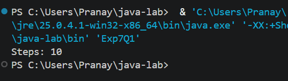
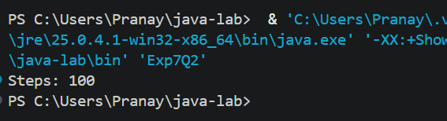
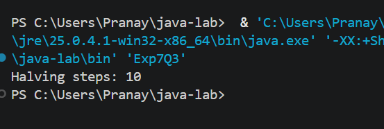

# EXPERIMENT NO. 7

## 1. Experiment Title
Counting Steps and Complexity

## 2. Aim
To count the steps a program takes, and write its time complexity as a comment.

## 3. Software / Tools Required
- Programming Language: Java (JDK 21)
- IDE: Visual Studio Code
- Version Control: Git and GitHub

## 4. Theory
- **Time complexity:** A measure of how the number of steps a program takes grows as the input size `n` grows.
- **O(n) - linear:** A single loop that runs `n` times.
- **O(n^2) - quadratic:** Two nested loops that both run `n` times, so the inner body runs `n * n` times.
- **O(log n) - logarithmic:** The input is halved in every step, so the loop runs about `log2(n)` times. For `n = 1024` this is 10 steps.
- **Counting steps:** A counter variable is increased every time the loop body runs.

## 5. Algorithm / Procedure

**Q1 - Single loop**
1. Start.
2. Set `steps = 0`.
3. Repeat for `i = 1` to `10` and increase `steps` by 1.
4. Print `Steps: ` followed by `steps`.
5. Stop. (Time complexity: O(n))

**Q2 - Nested loops**
1. Start.
2. Set `steps = 0`.
3. Repeat the outer loop for `i = 1` to `10`, and the inner loop for `j = 1` to `10`.
4. Increase `steps` by 1 in every run of the inner loop body.
5. Print `Steps: ` followed by `steps`.
6. Stop. (Time complexity: O(n^2))

**Q3 - Halving**
1. Start.
2. Store 1024 in `n` and set `count = 0`.
3. While `n > 1`, set `n = n / 2` and increase `count` by 1.
4. Print `Halving steps: ` followed by `count`.
5. Stop. (Time complexity: O(log n))

## 6. Program / Queries / Commands
The complete source code of each question is in its own folder:

| Question | Source file |
|----------|-------------|
| Q1 | [Q1/Exp7Q1.java](Q1/Exp7Q1.java) |
| Q2 | [Q2/Exp7Q2.java](Q2/Exp7Q2.java) |
| Q3 | [Q3/Exp7Q3.java](Q3/Exp7Q3.java) |

## 7. Input
- Q1: Loop from 1 to 10
- Q2: Both loops from 1 to 10
- Q3: `n = 1024`

## 8. Output

**Q1**
```
Steps: 10
```


**Q2**
```
Steps: 100
```


**Q3**
```
Halving steps: 10
```


## 9. Result
All three programs were written and executed successfully in Visual Studio Code. The steps of a single loop, nested loops and a halving loop were counted, and their time complexities O(n), O(n^2) and O(log n) were written as comments.

## 10. Viva-Voce Questions
1. What is time complexity?
2. What is the time complexity of a single loop that runs `n` times?
3. Why do two nested loops give O(n^2)?
4. Why is the halving loop in Q3 O(log n)?
5. How many steps will Q3 take if `n = 2048`?
