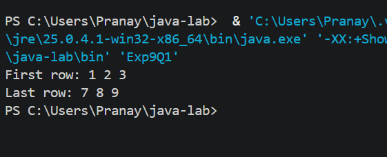
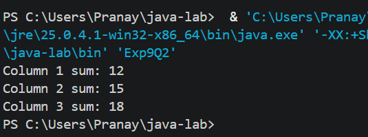
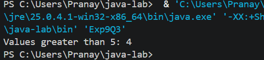

# EXPERIMENT NO. 9

## 1. Experiment Title
Matrices: Rows and Columns

## 2. Aim
To visit the rows and columns of a matrix with nested loops to print, add and count its values.

## 3. Software / Tools Required
- Programming Language: Java (JDK 21)
- IDE: Visual Studio Code
- Version Control: Git and GitHub

## 4. Theory
- **Matrix:** A two-dimensional array in which `m[i][j]` is the element in row `i` and column `j`. Indexes start from 0.
- **Printing a row:** Keep the row index fixed (for example `m[0][j]` for the first row) and loop over the columns `j`.
- **Column sum:** For a column sum the outer loop moves over the columns and the inner loop adds `m[i][j]` for every row `i`.
- **Counting values:** Visit every element with nested loops and increase a counter when the condition is true.

## 5. Algorithm / Procedure

**Q1 - First row and last row**
1. Start.
2. Create the 3 x 3 matrix `m` with rows 1 2 3, 4 5 6 and 7 8 9.
3. Print `First row: ` and then `m[0][j]` for `j = 0` to `2`, with a space after each value.
4. Print `Last row: ` and then `m[2][j]` for `j = 0` to `2`, with a space after each value.
5. Stop.

**Q2 - Column sums**
1. Start.
2. Create the 3 x 3 matrix `m` with rows 1 2 3, 4 5 6 and 7 8 9.
3. For each column `j`, set `sum = 0` and add `m[i][j]` for every row `i`.
4. Print `Column ` followed by the column number, ` sum: ` and `sum`.
5. Stop.

**Q3 - Count values greater than 5**
1. Start.
2. Create the 3 x 3 matrix `m` with rows 1 2 3, 4 5 6 and 7 8 9, and set `count = 0`.
3. Using nested loops, increase `count` by 1 whenever `m[i][j] > 5`.
4. Print `Values greater than 5: ` followed by `count`.
5. Stop.

## 6. Program / Queries / Commands
The complete source code of each question is in its own folder:

| Question | Source file |
|----------|-------------|
| Q1 | [Q1/Exp9Q1.java](Q1/Exp9Q1.java) |
| Q2 | [Q2/Exp9Q2.java](Q2/Exp9Q2.java) |
| Q3 | [Q3/Exp9Q3.java](Q3/Exp9Q3.java) |

## 7. Input
- Q1: Matrix with rows `1 2 3`, `4 5 6` and `7 8 9`
- Q2: Matrix with rows `1 2 3`, `4 5 6` and `7 8 9`
- Q3: Matrix with rows `1 2 3`, `4 5 6` and `7 8 9`

## 8. Output

**Q1**
```
First row: 1 2 3 
Last row: 7 8 9 
```


**Q2**
```
Column 1 sum: 12
Column 2 sum: 15
Column 3 sum: 18
```


**Q3**
```
Values greater than 5: 4
```


## 9. Result
All three programs were written and executed successfully in Visual Studio Code. The first and last rows of a matrix were printed, the sum of each column was calculated, and the values greater than 5 were counted using nested loops.

## 10. Viva-Voce Questions
1. How do you access the first row and the last row of a matrix?
2. How is a column sum different from a row sum in terms of the loops?
3. What is the index of the last row in a matrix with 3 rows?
4. Which values are counted in Q3?
5. What is the time complexity of Q3 for an `n x n` matrix?
